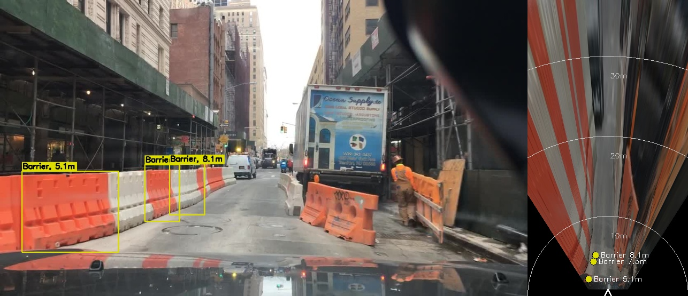
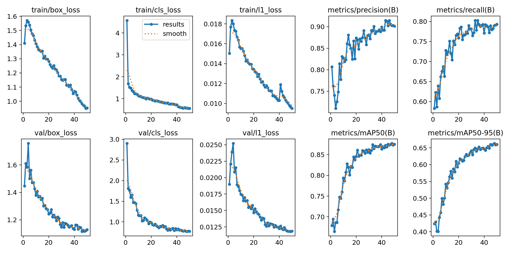
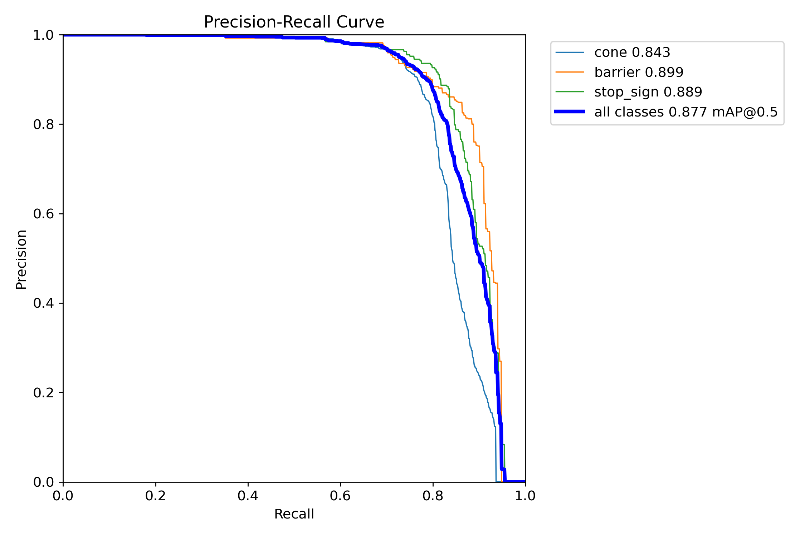
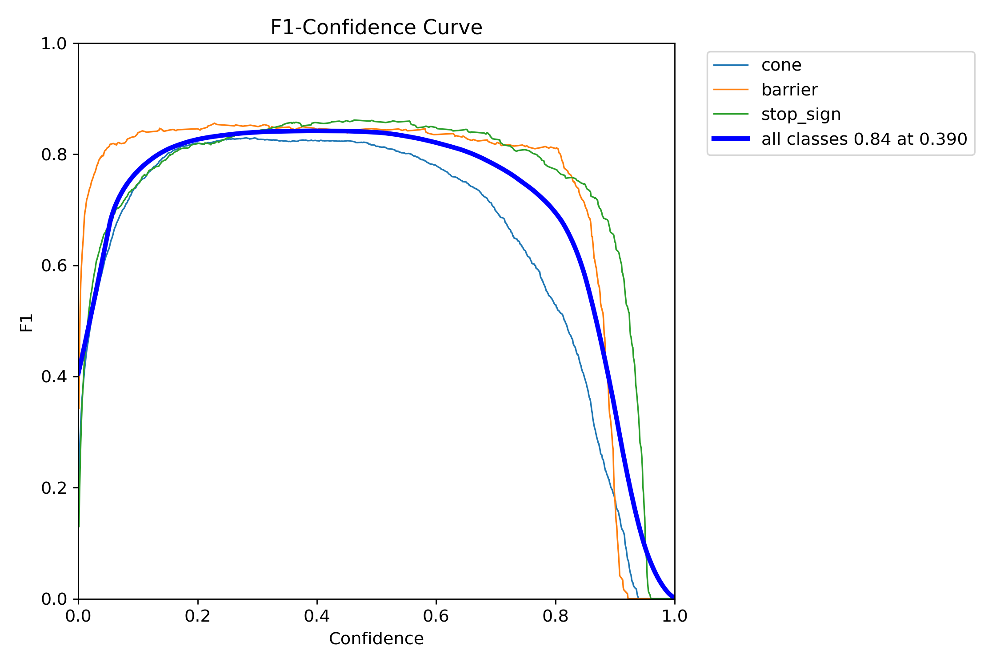
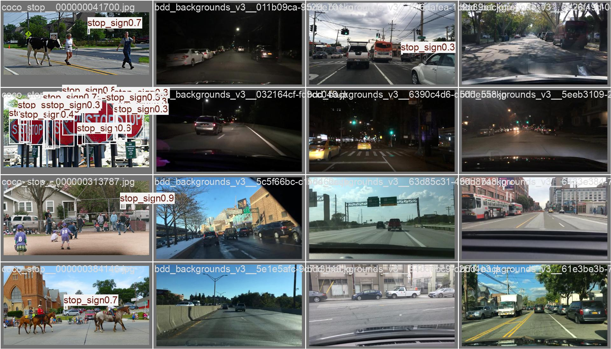
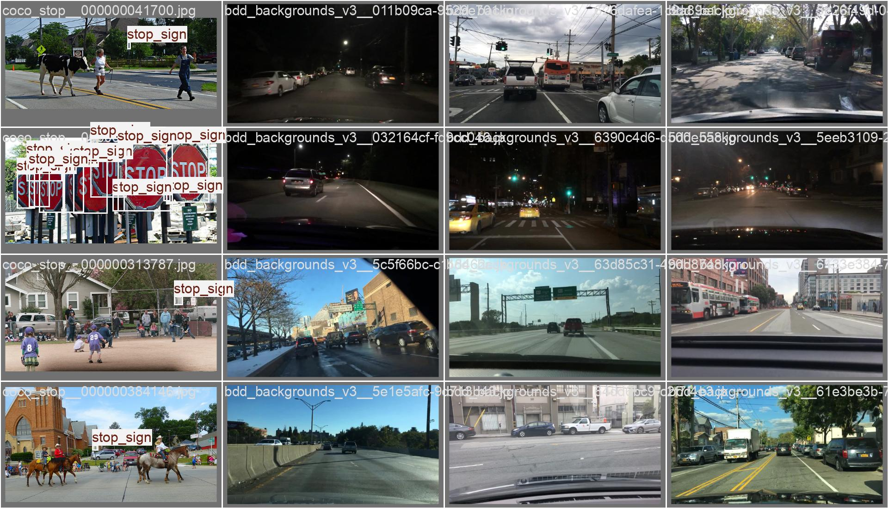
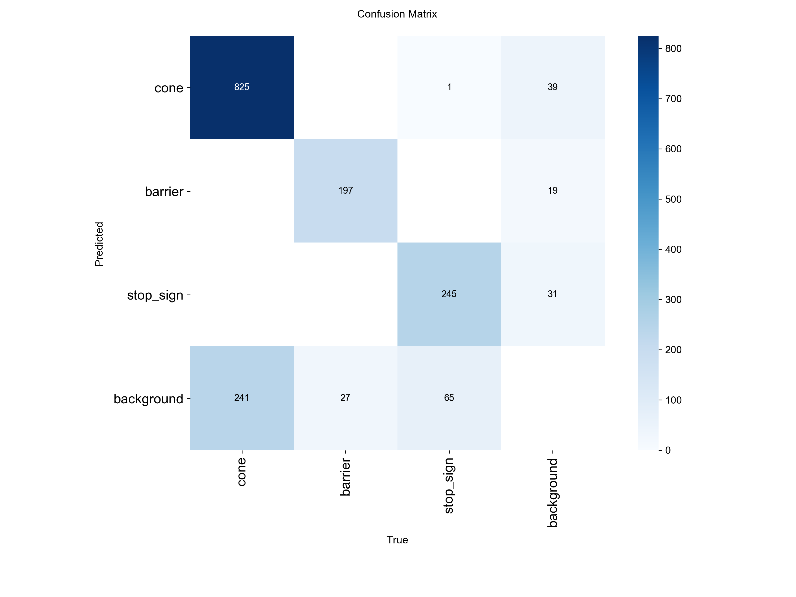

# Object Detection + Distance Estimation for Robotics Navigation

[](../../actions/workflows/ci.yml)

This project detects traffic cones, barriers and stop signs in driving scenes, works out
how far away each one is from a single camera, and labels the box with it, e.g. `Cone, 4.2m`.

The detector is a COCO-pretrained YOLO26n that I fine-tuned on a merged three-class dataset.
I then made it faster for edge hardware (INT8 quantization, FP16, smaller input, pruning) and
benchmarked it on CPU and GPU. As extras, I added a bird's-eye view built from a ground-plane
homography, and optical-flow tracking that estimates time-to-contact.



## Results at a glance

- **Detection:** mAP50 0.877 on the validation set (1012 images) and 0.883 on a held-out test
  set (1016 images) that was only scored once at the end. Per class on val: cone 0.843,
  barrier 0.898, stop sign 0.889.
- **Real driving scenes:** on 500 unseen BDD100K frames, 8 of the 11 detections were correct,
  including real cones that an earlier version of the model missed.
- **Speed:** 31.6 FPS on the Apple M3 CPU, and 54.1 FPS after INT8 quantization (1.7× faster,
  3.44 MB, −2.3 mAP50). The M3 GPU runs the FP32 model at 50.4 FPS.
- **Distance:** a size-based estimate and an independent road-contact estimate agree within
  8–15%.
- **Time-to-contact:** median error 8.6% on a simulated approach with known ground truth.

Every decision, including the ones that didn't work out, is written up with its reasoning in
[`docs/PROJECT_LOG.md`](docs/PROJECT_LOG.md). [`docs/MODEL_CARD.md`](docs/MODEL_CARD.md) covers
intended use and limitations.

## How the assignment objectives are covered

| Objective | What I did | Where |
|---|---|---|
| Detect cones, barriers, stop signs | Merged COCO stop signs, two Roboflow datasets (cones, barriers) and BDD100K driving scenes. BDD100K has no cone or barrier labels, so I used it for screened "background" frames that teach the model what isn't a target | [Data](#1-data), `src/data/` |
| Transfer learning | Fine-tuned all layers of a COCO-pretrained YOLO26n. COCO already has a `stop sign` class, which gave that class a head start | [Detection](#2-detection-transfer-learning), `src/train.py` |
| Clean, modular code | One script per stage, each importable and usable from the command line; 27 tests, ruff and CI | [Layout](#repository-layout) |
| Distance per object | Pinhole model `Z = f · H / h` with real object heights from a config file, cross-checked with a homography | [Distance](#3-distance-estimation), `src/distance.py` |
| Labels like `Cone, 1.5m` | Drawn on images, video and the live camera feed | `src/detect.py` |
| Edge optimization | INT8 static quantization, L1 pruning (10/30/50%), a lightweight backbone, FP16 and 320 px input, each measured before and after | [Optimization](#4-edge-optimization), `src/optimize.py` |
| CPU vs GPU FPS | CPU 31.6 → 54.1 FPS with INT8; GPU 50.4 FPS | `results/benchmark_m3.md` |
| Extras | Bird's-eye view (homography) and optical-flow tracking | [Extras](#6-extras) |

## How to run it

The trained weights are in the repo (`models/yolo26n_nav_v3.pt`, 5.4 MB), so you don't need
any dataset or training to try it. Run everything from the project root.

**1. Get the code and set up the environment** (Python 3.10):

```bash
git clone <this-repo-url> object_detection
cd object_detection
make setup                    # or: python3.10 -m venv .venv && .venv/bin/pip install -r requirements.txt -r requirements-serve.txt -r requirements-dev.txt
source .venv/bin/activate     # if Anaconda is active, run `conda deactivate` first
make test                     # 27 tests, takes about 2 s
```

**2. Try it on the sample images:**

```bash
python src/detect.py --source assets/samples --out results/annotated
```

The annotated images are saved to `results/annotated/`.

**3. Run it on your own images or video:**

```bash
python src/detect.py --source path/to/image.jpg            # one image
python src/detect.py --source path/to/folder/              # a folder of images
python src/detect.py --source path/to/video.mp4            # a video (saves an annotated copy)
python src/detect.py --source video.mp4 --weights models/yolo26n_nav_v3_int8.onnx   # INT8 model, faster on CPU
```

**4. Use your laptop webcam:**

```bash
python src/detect.py --list-cameras                   # the built-in webcam is usually camera 0
python src/detect.py --source 0 --device mps          # Apple GPU; use --device cpu, or 0 for an NVIDIA GPU
python src/detect.py --source 0 --device mps --save   # also records the session
```

Press `q` or `Esc` to close the window. A few things to know:
- On macOS, the first run asks for camera permission for your terminal. If the window stays
  black, enable it under System Settings → Privacy & Security → Camera and restart the terminal.
- Webcam distances are only rough. The config assumes a 65° dash camera and full-size
  objects, so a toy cone or a stop sign shown on a phone screen will read farther away than
  it is. See [calibrating the camera](#calibrating-for-your-own-camera) to fix this.
- `--source` also accepts an `http://` or `rtsp://` stream, such as a phone camera app.

**5. Extras and the API:**

```bash
make bev                      # bird's-eye views -> results/bev
make flow-demo                # optical-flow tracking + time-to-contact -> results/flow
make serve                    # REST API on localhost:8000 (docs at /docs)
curl -F file=@assets/samples/bca36352-acc82f86.jpg localhost:8000/detect
make docker                   # the same API in Docker
```

**6. EDA and evaluation.** These need the dataset, built as described in
[Reproducing from scratch](#reproducing-from-scratch):

```bash
make eda                                                                  # -> results/eda/summary.md
yolo val model=models/yolo26n_nav_v3.pt data=data/merged_v3/data.yaml    # per-class P, R, mAP
yolo val model=runs/train/yolo26n_nav_v4/weights/best.pt data=data/merged_v4/data.yaml split=test conf=0.35
make optimize benchmark                                                   # speed/accuracy of every variant
make eval-bdd                                                             # check on 500 BDD100K scenes
```

`make help` lists all the targets.

## Pipeline

```
COCO stop signs ─┐
Roboflow cones ──┼─► merge_datasets.py ─► 3-class YOLO dataset ─► train.py (Colab T4)
Roboflow barriers┘        ▲                                          │
BDD100K backgrounds ──────┘ (filtered by select_bdd_backgrounds.py)  ▼
                                                     models/yolo26n_nav_v3.pt
              ┌──────────────────────┬───────────────────────┼──────────────────────┐
              ▼                      ▼                       ▼                      ▼
   detect.py + distance.py     bev.py / flow.py         optimize.py           evaluate_bdd.py
   "Cone, 4.2m"                top-down map, TTC        ONNX / INT8 / pruned  real-scene check
                                                             ▼
                                                       benchmark.py (mAP + FPS)
```

## 1. Data

BDD100K doesn't have cone or barrier classes, and it puts stop signs under a general
`traffic sign` label. So I took one dataset per class and merged them into a single
three-class set (`0 cone, 1 barrier, 2 stop_sign`):

| Class | Source |
|---|---|
| Stop sign | COCO 2017 `stop sign` images (`src/data/download_coco_stop.py`) |
| Cone | Roboflow Universe [cones-mapit v2](https://universe.roboflow.com/arrows-d3g7d/cones-mapit/dataset/2) (CC BY 4.0), capped at 3000 images |
| Barrier | Roboflow Universe [barriers-ctzjn v2](https://universe.roboflow.com/evoiz/barriers-ctzjn/dataset/2) (CC BY 4.0) |
| Background (no objects) | 900 BDD100K driving scenes with vehicles, half of them with other traffic signs |

The background frames are there to teach the model that cars, tail lights and other red
signs are not targets. The dataset went through three versions:

- **v1:** COCO and Roboflow only. The model called cars, flowers and road markings "cones".
- **v2:** added 900 BDD100K backgrounds. Most false positives went away, but the model also
  stopped finding real cones. BDD100K doesn't label cones, so some background frames
  contained cones and taught the model to ignore them.
- **v3 (final):** every candidate background is screened by three detectors and dropped if
  any of them sees a target, and half the backgrounds contain other traffic signs. This
  brought the real cones back and taught the model that other signs aren't stop signs.

The final set has 5753 training and 1012 validation images. Roboflow ships several augmented
copies of each photo, so the split is grouped by original image; otherwise copies of the same
photo would end up in both training and validation.

### Exploratory data analysis

`src/data/eda.py` writes [`results/eda/summary.md`](results/eda/summary.md). What I found,
and what I did about it:

- **The training objects are mostly close-up.** From box sizes, the barriers are 0.9–3.4 m
  away and the cones 0.7–12.6 m (10th–90th percentile). That explains why recall drops on
  distant objects in driving scenes (5–40 m). Far-range examples are the obvious next data
  to add.
- **Only 1 of 6765 images contains two different classes,** so the model never sees mixed
  scenes during training. I checked that case on real BDD scenes instead.
- **90 near-duplicate cone boxes** (IoU > 0.9). Removed with `--dedup-iou 0.9` in v4.
- **18% of cone boxes are cut off by the image border.** A cut-off box looks shorter than
  the object, so its distance reads too far. This is listed as a limitation.
- **Some COCO "stop sign" labels are other round red signs,** such as a no-parking sign. This
  partly explains the red-sign false positives, which I handle with a stricter stop-sign
  threshold.
- **307 different image resolutions,** from 512² to 1280×720. Letterboxing to 640 px handles
  this for the detector, and the distance code rescales the focal length to the image width.

Class balance in the v4 split:

| Split | Images | Backgrounds | Cone | Barrier | Stop sign |
|---|---|---|---|---|---|
| train | 4737 | 630 (13%) | 5589 | 1015 | 1435 |
| val | 1012 | 135 (13%) | 1265 | 234 | 312 |
| test | 1016 | 135 (13%) | 1066 | 224 | 311 |

There are about five times as many cone boxes as barrier boxes, and cone images can be very
crowded (up to 47 cones in one image). That is why cone has the most labels but the lowest
mAP50-95: lots of small, overlapping boxes are hard to localize precisely.

| Box size and implied distance per class | Where boxes sit in the image |
|---|---|
|  |  |

Random training samples (rows: cone, barrier, stop sign):


## 2. Detection (transfer learning)

I fine-tuned YOLO26n (Ultralytics 8.4.188) from COCO weights for 50 epochs at 640 px with
batch 32 on a Colab T4, which took about 1.2 hours (`notebooks/train_colab.ipynb`).

Validation results for the final (v3) model:

| Class | Precision | Recall | mAP50 | mAP50-95 |
|---|---|---|---|---|
| cone | 0.940 | 0.737 | 0.843 | 0.536 |
| barrier | 0.880 | 0.814 | 0.898 | 0.706 |
| stop_sign | 0.900 | 0.824 | 0.889 | 0.748 |
| all | 0.906 | 0.792 | 0.877 | 0.663 |

### Evaluation plots

All plots are in [`results/metrics/`](results/metrics/).

In the training curves, train and validation losses fall together, and validation mAP levels
off over the last ten epochs (best at epoch 48). Validation loss never turns back up, so the
model isn't overfitting, and more epochs wouldn't add much.



| Precision–recall curve (val) | F1 vs confidence (val) |
|---|---|
|  |  |

The F1 curve peaks at 0.84 at a confidence of 0.39, so I use 0.35 as the detection threshold.
Stop-sign F1 stays almost flat up to about 0.7, so for stop signs I raised the threshold to
0.7. That removes most of the confusion with DO NOT ENTER and diamond-shaped signs: precision
goes from 0.904 to 0.969, while recall drops from 0.814 to 0.705.

| Predictions on a validation batch | Ground truth for the same batch |
|---|---|
|  |  |

### Held-out test set

I used the validation set to pick the best epoch and the stop-sign threshold, which makes
its scores slightly optimistic. To get an honest number, I rebuilt the dataset as a
70/15/15 train/val/test split (v4), retrained with the same settings, and scored the test set
once at the end. It got mAP50 0.883 and mAP50-95 0.657, compared with 0.854 on v4's own
validation set. The test score isn't lower than the validation score, so the tuning didn't
overfit to the validation set.

The confusion matrix below is computed at the threshold the detector actually uses. The
default one from Ultralytics is drawn at almost zero confidence and is full of boxes that
would never be shown. Only one test object was given the wrong class; nearly all the errors
are missed objects, mostly small cones.



| Class | Recall | Precision |
|---|---|---|
| cone | 0.77 | 0.95 |
| barrier | 0.88 | 0.91 |
| stop sign | 0.73 | 0.97 |

The shipped model is still v3. It uses the same recipe but trained on 18% more data, because
the test images didn't need to be held back (details in `docs/PROJECT_LOG.md`, Step 20).

## 3. Distance estimation

Distance is estimated from a single camera with the pinhole camera model
(`src/distance.py`). All the parameters are in [`configs/camera.yaml`](configs/camera.yaml).

### How it works

The camera and the real object form one triangle, and the camera and the object's image on
the sensor form a second, similar one. So the object's height in pixels relates to its real
height the same way the focal length relates to the distance:

```
            real object                        image plane
   ┬ ......................                      ┬
   │ H_real                ' ' ' ' ' ' ' ' ' ' ' │ h_px
   ┴ ...................... . . . . . . . . . .  ┴
   |<---------- Z (distance) ---------->|<-- f_px -->|  camera

        h_px / f_px = H_real / Z     =>     Z = f_px × H_real / h_px
```

For each detected box:

1. Take the box height in pixels (`h_px`). For stop signs I use the larger side, because the
   sign is as wide as it is tall, so a partly cut-off sign still gives a usable size.
2. Look up the real height for that class (`H_real`, below).
3. Work out the focal length in pixels: `f_px = (W / 2) / tan(HFOV / 2)`. With the assumed
   65° dash-cam field of view this is about 1005 px for a 1280 px-wide image. It is rescaled
   to the actual image width, so any resolution works.
4. Compute `Z = f_px × H_real / h_px` and write it on the box.

For example, a cone 70 px tall in a 1280 px frame is 1005 × 0.70 / 70 ≈ 10.1 m away.

### Object heights

| Class | Height | Based on |
|---|---|---|
| Cone | 0.70 m | A standard 28-inch traffic cone, the most common road-works size |
| Barrier | 1.00 m | A-frame / Type I–II barricades; real barriers range from 0.8 to 1.5 m |
| Stop sign | 0.75 m | The standard 30-inch (750 mm) sign face, not including the pole |

The distance is directly proportional to these heights. If the real object is half the
assumed height, such as a 35 cm toy cone, every distance comes out twice as far. Getting the
height right matters as much as getting the detection right.

### Changing the heights

Edit the `objects` section of [`configs/camera.yaml`](configs/camera.yaml). The values are
in metres:

```yaml
objects:
  cone:
    height_m: 0.70     # e.g. 0.45 for 18-inch cones, or 0.30 for small training cones
  barrier:
    height_m: 1.00     # e.g. 1.20 for tall road-works barricades
  stop_sign:
    height_m: 0.75     # e.g. 0.60 for small (600 mm) signs
    use_max_side: true
```

You don't need to retrain anything. The detector only finds the box, and the config turns
its size into metres. The new values are picked up the next time you run `detect.py`,
`bev.py`, `flow.py` or the API.

To keep the defaults and use your own file instead (say, for a different robot):

```bash
cp configs/camera.yaml configs/my_setup.yaml                  # edit the heights in the copy
python src/detect.py --source 0 --camera configs/my_setup.yaml
CAMERA_CFG=configs/my_setup.yaml make serve                    # for the REST API
```

### Calibrating for your own camera

BDD100K doesn't publish camera intrinsics, so the default focal length comes from an
assumed 65° field of view. For a different camera (a webcam, a phone, the robot's own
camera) you can either:

- Pass its field of view from the spec sheet: `python src/detect.py --source 0 --hfov 78`,
  or set `hfov_deg: 78` in the config.
- Measure it once. Put an object at a known distance, note its box height, and compute
  `f = Z × h_px / H_real`:

  ```bash
  # a 0.70 m cone placed 2.0 m away shows up 380 px tall in a 1280 px-wide frame
  python -c "import sys; sys.path.insert(0, 'src'); from distance import calibrate_focal; print(calibrate_focal(2.0, 380, 0.70))"
  # -> 1085.7, so set focal_px: 1085.7 (with ref_width: 1280) in configs/camera.yaml
  ```

  If both are set, `focal_px` takes priority over `hfov_deg`.

### Limitations

- The method assumes standard-size objects; anything bigger or smaller gives a
  proportionally wrong distance unless you update the heights.
- Boxes cut off at the edge of the image look shorter than the object, so they read too
  far. 18% of the training cone boxes touch the border.
- Until the camera is calibrated, the assumed field of view adds a constant scale error.

As a sanity check, the bird's-eye view (§6) estimates distance a completely different way:
from where the object touches the road. On the barrier samples the two methods agree within
8–15%.

## 4. Edge optimization

`src/optimize.py` builds the variants, and `src/benchmark.py` measures each one's accuracy
(val mAP) and its end-to-end single-frame FPS, including pre- and post-processing.

These are the results on an Apple M3 (8 GB) with the v3 model, averaged over 200 frames
(`results/benchmark_m3.md`):

| Variant | Device | Input | mAP50 | mAP50-95 | FPS | Size (MB) |
|---|---|---|---|---|---|---|
| PyTorch FP32 (baseline) | CPU | 640 | 0.867 | 0.651 | 31.6 | 5.44 |
| PyTorch FP32 | GPU (MPS) | 640 | 0.867 | 0.651 | 50.4 | 5.44 |
| PyTorch FP16 | GPU (MPS) | 640 | 0.866 | 0.651 | 52.3 | 5.44 |
| ONNX Runtime FP32 | CPU | 640 | 0.867 | 0.651 | 34.5 | 9.85 |
| ONNX Runtime INT8 (static PTQ) | CPU | 640 | 0.844 | 0.637 | **54.1** | **3.44** |
| ONNX Runtime FP32 | CPU | 320 | 0.744 | 0.547 | 117.9 | 9.73 |
| Pruned 10% (L1 unstructured) | CPU | 640 | 0.864 | 0.650 | 30.8 | 5.48 |
| Pruned 30% | CPU | 640 | 0.713 | 0.497 | 30.9 | 5.48 |
| Pruned 50% | CPU | 640 | 0.183 | 0.129 | 29.2 | 5.48 |

The mAP here comes from batch-1, non-rectangular validation so that every variant is measured
the same way. That's why it's a little below the training-time numbers above.

What I took from this:
- **INT8 quantization is the best CPU option.** It's 1.7× faster than the baseline and 37%
  smaller, and costs 2.3 mAP50 points. I kept the detection head in FP32: box coordinates are
  sensitive to rounding, and the head is only a small part of the compute.
- **The M3 GPU gives about 1.6×.** FP16 adds very little on Apple GPUs for a model this small.
- **Dropping the input to 320 px is 3.7× faster** but loses 12 mAP50 points, mostly on small,
  distant objects. That's only worth it if objects are always close.
- **Pruning didn't help speed.** Unstructured pruning only sets weights to zero, and the
  dense CPU kernels still multiply those zeros. Accuracy also falls off quickly past 10%.
  A real speed-up would need structured (channel) pruning followed by fine-tuning.
- The backbone itself is already lightweight: YOLO26n has 2.5 M parameters and doesn't need NMS.

## 5. Results on real driving scenes

Validation scores don't tell you how the model behaves on real roads, so `src/evaluate_bdd.py`
runs each model version on the same 500 BDD100K validation scenes, which were never used in
training. It saves a zoomed crop of every detection, and I checked each one by eye
(`results/bdd_eval/`). Thresholds: 0.35, and 0.7 for stop signs.

| Model | Detections | Correct | Real cones found | Notes |
|---|---|---|---|---|
| v1 (1 epoch, no backgrounds) | 16 | mostly false | ≈ 3 of 12 | cars, flowers and road markings called cones |
| v2 (unfiltered backgrounds) | 5 | 4 | 0 | clean, but misses real cones |
| v3 (filtered backgrounds) | 11 | 8 | 2 | finds cones, barriers and stop signs; 3 errors (DO NOT ENTER, hand signal, brake lights) |

The training cones are mostly orange, so the small yellow-green cones in some scenes are
missed. Red signs of other types are still the main source of false positives. Annotated
examples are in `results/annotated/`.

## 6. Extras

### Bird's-eye view with homography (`src/bev.py`)

If the road is flat, mapping image pixels to ground positions is a homography, built from the
focal length, the camera height (1.3 m) and the horizon row. I warp the image onto a top-down
metric grid and plot each object at its distance and sideways offset. For cones and barriers,
the bottom edge of the box gives a second, independent distance, from where the object touches
the road:

| Object | Size-based | Road contact | Agreement |
|---|---|---|---|
| Barrier (3 boxes) | 5.1 / 7.3 / 8.1 m | 5.6 / 8.3 / 9.3 m | within 8–15% |
| Cone | 18.1 m | 20.7 m | 13% |
| Orange road post (≈1.2 m tall, detected as a cone) | 3.2 m | 5.9 m | the size method assumes a 0.7 m cone, so it reads too close |

The horizon row depends on how the camera is mounted, so it can be set per camera with
`--horizon-frac` (the height where the lane lines meet). Outputs are in `results/bev/`.

### Optical flow: tracking and time-to-contact (`src/flow.py`)

Corner points inside each box are tracked with pyramidal Lucas-Kanade optical flow, with a
forward-backward check to drop bad points. The flow is used for three things:

1. Predicting where each box will be next, so a track survives up to 10 frames in which the
   detector misses the object.
2. Measuring how fast the object grows in the image. That gives time-to-contact,
   `TTC = dt / (s − 1)`, without any camera calibration.
3. Closing speed, which is distance ÷ TTC.

I didn't have driving video, so `src/simulate_approach.py` turns a real BDD100K frame into a
45-frame approach toward a cone at 8 m/s with exact ground truth:
- The cone was tracked in 44 of 45 frames: 29 by the detector, the rest bridged by flow.
- TTC error had a median of 8.6% and a maximum of 23%.
- The estimated closing speed was 6.5–8.8 m/s, against a true 8 m/s.

The output video and per-frame CSV are in `results/flow/`.

## 7. Deployment

There's a small REST API (`src/serve.py`, FastAPI) with interactive docs at `/docs`:

```bash
make serve                                   # or: docker build -t nav-detector . && docker run -p 8000:8000 nav-detector
curl -F file=@assets/samples/c6f14304-e9ad93b9.jpg localhost:8000/detect
```
```json
{"image_size": {"width": 1280, "height": 720}, "inference_ms": 34.6,
 "detections": [{"class": "cone", "confidence": 0.595, "box_xyxy": [1129.8, 326.8, 1151.5, 365.6], "distance_m": 18.12}]}
```

It has three endpoints:
- `GET /health` returns the model in use, the classes and the per-class thresholds.
- `POST /detect` returns the detections and their distances as JSON.
- `POST /detect/image` returns the annotated image as a JPEG.

Setting `MODEL_PATH=models/yolo26n_nav_v3_int8.onnx` serves the INT8 model instead. The Docker
image runs as a non-root user and has a health check. On every push, CI builds the image and
sends a real request to the running container.

## Repository layout

```
assets/samples/                  4 BDD100K val frames used by the demos
configs/camera.yaml              camera FOV / height / horizon + real object heights
docs/PROJECT_LOG.md              every step, with reasons
docs/MODEL_CARD.md               intended use, data, metrics, limitations
models/                          final weights: PyTorch FP32 + ONNX INT8
notebooks/train_colab.ipynb      Colab training notebook
results/                         EDA, evaluation plots, benchmarks, BDD comparison, demo outputs
src/data/download_coco_stop.py   download COCO stop-sign images only
src/data/select_bdd_backgrounds.py  pick + filter BDD100K background scenes
src/data/merge_datasets.py       build the 3-class YOLO dataset (train/val/test)
src/data/eda.py                  exploratory data analysis -> results/eda
src/train.py                     fine-tune YOLO26n
src/distance.py                  pinhole distance estimator
src/detect.py                    annotate images / folders / video / webcam with "Class, X.Xm"
src/optimize.py                  ONNX export, INT8 quantization, pruning
src/benchmark.py                 mAP + CPU/GPU FPS for every variant
src/evaluate_bdd.py              model comparison on BDD100K scenes
src/bev.py                       bird's-eye view (homography) + road-contact distance
src/flow.py                      optical-flow tracking + time-to-contact
src/simulate_approach.py         synthetic approach video with ground-truth TTC
src/serve.py                     REST inference API (FastAPI)
Dockerfile                       CPU inference container
tests/                           unit + API tests
```

Datasets, intermediate weights and training runs aren't committed (see `.gitignore`).

## Reproducing from scratch

```bash
# 1. Data: export the two Roboflow datasets in "YOLOv8" format into data/raw/roboflow_cones and
#    data/raw/roboflow_barriers, and put BDD100K images + detection labels in data/raw/bdd100k
make data          # COCO stop signs, filtered BDD backgrounds, data/merged_v3
make data-v4       # same data with a held-out test split

# 2. Train (a GPU is recommended; on Colab, use notebooks/train_colab.ipynb)
make train         # -> runs/train/yolo26n_nav_v3/weights/best.pt

# 3. Optimize and benchmark (uses models/yolo26n_nav_v3.pt)
make optimize benchmark
make eval-bdd      # v1 / v2 / v3 on 500 BDD100K val scenes
```

`make data` screens the backgrounds with the earlier v1/v2 models (`runs/train/...`), which
aren't committed. You can pass any detectors you have to `--filter-models`, or drop the flag.

To lint and test: `make lint test`.

## Acknowledgements and licenses

- [Ultralytics YOLO26](https://github.com/ultralytics/ultralytics) (AGPL-3.0)
- [COCO 2017](https://cocodataset.org) (annotations CC BY 4.0)
- Roboflow Universe [cones-mapit](https://universe.roboflow.com/arrows-d3g7d/cones-mapit/dataset/2)
  and [barriers-ctzjn](https://universe.roboflow.com/evoiz/barriers-ctzjn/dataset/2) (CC BY 4.0)
- [BDD100K](https://bdd-data.berkeley.edu) (non-commercial research license). The frames in
  `assets/samples/` and `results/` are only used for demonstration.
