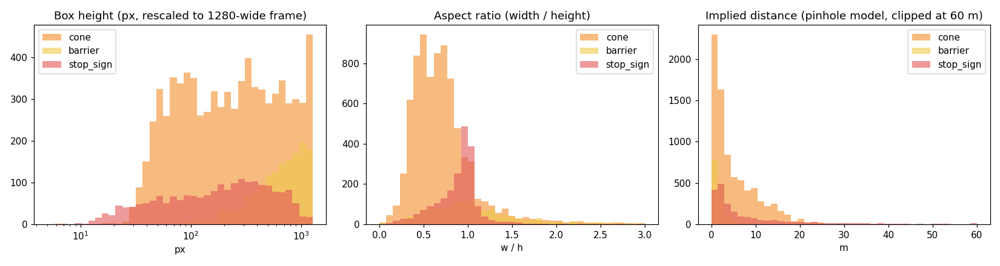
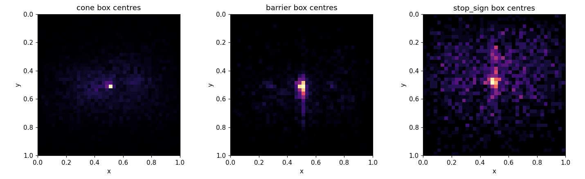
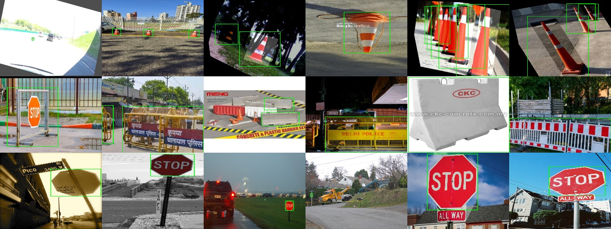

# EDA — `data/merged_v4`

Generated by `src/data/eda.py`.

## 1. Split and class balance

| split | images | backgrounds | cone | barrier | stop_sign |
|---|---|---|---|---|---|
| train | 4737 | 630 (13%) | 5589 | 1015 | 1435 |
| val | 1012 | 135 (13%) | 1265 | 234 | 312 |
| test | 1016 | 135 (13%) | 1066 | 224 | 311 |

Instances by source (all splits):

| source | images | cone | barrier | stop_sign |
|---|---|---|---|---|
| bdd_backgrounds_v3 | 900 | 0 | 0 | 0 |
| coco_stop | 1803 | 0 | 0 | 2058 |
| roboflow_barriers | 1062 | 1 | 1473 | 0 |
| roboflow_cones | 3000 | 7919 | 0 | 0 |

Objects per image: median 1, max 47. Images with 2+ different classes: 1 (0.0%).

## 2. Box geometry

| class | boxes | median height px | small (<32 px) | median w/h | implied distance p10–p90 (m) |
|---|---|---|---|---|---|
| cone | 7920 | 232 | 1% | 0.66 | 0.7 – 12.6 |
| barrier | 1473 | 701 | 0% | 1.00 | 0.9 – 3.4 |
| stop_sign | 2058 | 196 | 10% | 0.94 | 1.0 – 23.2 |

## 3. Label quality

| class | near-duplicate boxes (IoU > 0.9) | cut by image border | tiny (< 4 px side) |
|---|---|---|---|
| cone | 0 | 1302 | 6 |
| barrier | 0 | 494 | 1 |
| stop_sign | 0 | 136 | 4 |

## 4. Image resolutions

| width × height | images |
|---|---|
| 640 × 640 | 3020 |
| 512 × 512 | 1062 |
| 1280 × 720 | 900 |
| 640 × 480 | 436 |
| 480 × 640 | 200 |
| 640 × 427 | 156 |

307 distinct resolutions in total.

## 5. Random training samples (rows: cone, barrier, stop sign)

